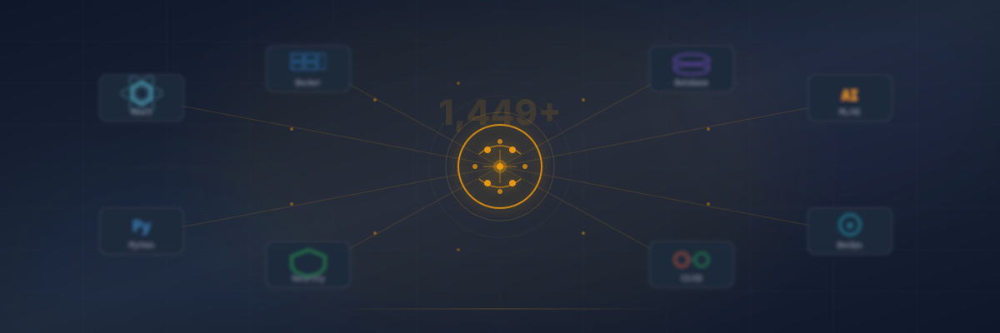
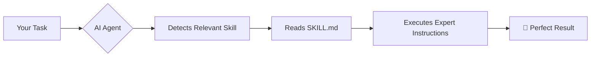

<div align="center">
  
</div>

<br/>

<div align="center">
  <h1>🧠 Antigravity Awesome Group Skills</h1>
  <p><strong>1,449+ curated AI agent skills</strong> — the ultimate playbook collection for AI-assisted development</p>

  <!-- Badges -->
  <p>
    <a href="https://github.com/YOUR-USERNAME/antigravity-awesome-group-skills/stargazers">
      
    </a>
    <a href="./LICENSE">
      
    </a>
    <a href="https://github.com/YOUR-USERNAME/antigravity-awesome-group-skills/issues">
      
    </a>
    <a href="./CONTRIBUTING.md">
      
    </a>
    
    
    
    <a href="https://opensource.org/licenses/MIT">
      
    </a>
  </p>
</div>

<br/>

<details open>
  <summary><strong>📖 Table of Contents</strong></summary>

- [📜 About](#-about)
- [💡 Motivation](#-motivation)
- [✨ Features](#-features)
- [🎯 How Skills Work](#-how-skills-work)
- [🖥️ Compatible Tools](#%EF%B8%8F-compatible-tools)
- [🏆 Skills by Mission / Task](#-skills-by-mission--task)
- [📂 Skill Categories](#-skill-categories)
- [🔗 Quick Links](#-quick-links)
- [🛠️ For Your Current Project](#%EF%B8%8F-for-your-current-project)
- [🤝 Contributing](#-contributing)
- [📄 License](#-license)
- [🏷️ Tags](#%EF%B8%8F-tags)
</details>

---

## 📜 About

**Antigravity Awesome Group Skills** is the largest curated collection of **agentic AI skill playbooks** for AI coding assistants. Each skill is a `SKILL.md` file that teaches the AI how to handle a specific task — from React components and Docker deployment to security audits and SEO optimization.

> Think of skills as **superpowers for your AI assistant**. Instead of telling the AI *how* to do everything from scratch, skills provide pre-written expertise that activates automatically when needed.

This repository serves as both:
- 📚 **A reference catalog** — browse and discover what skills exist
- 📦 **A distribution source** — skills can be installed into any compatible AI tool
- 🏗️ **A contribution hub** — the community grows this collection together

---

## 💡 Motivation

Modern AI coding assistants are incredibly powerful, but they lack **specialized domain knowledge** out of the box. Every time you ask an AI to deploy Docker, write a security audit, or set up CI/CD, it has to reason through the details from scratch.

**Skills solve this.** They give AI assistants curated, battle-tested instructions for specific tasks, so you get:

| Before Skills | After Skills |
|---|---|
| ❌ Generic, sometimes outdated advice | ✅ Expert-level, curated instructions |
| ❌ Inconsistent quality across sessions | ✅ Predictable, repeatable results |
| ❌ Time spent explaining context | ✅ AI understands the task immediately |
| ❌ Security gaps from missing steps | ✅ Complete, vetted workflows |
| ❌ Tribal knowledge lost over time | ✅ Skills are documented and shared |

This repository was created to **democratize AI agent expertise** — anyone can contribute, anyone can benefit, and the collection grows stronger with every contribution.

---

## ✨ Features

- **1,449+ skills** organized across 26 domains
- **23 mission-based workflows** — pre-deployment, security audit, TDD, etc.
- **Automatic detection** — AI activates skills based on your task
- **Cross-platform** — works with Antigravity IDE, Claude Code, Cursor, Gemini CLI
- **Plugin support** — domain-specific bundles (e.g., Firebase)
- **MIT licensed** — free for any use
- **Community-driven** — PRs welcome from everyone
- **SEO/AEO ready** — generative engine optimized discovery
- **1,000+ AI personas & specialized domains** — healthcare, legal, finance, gaming, blockchain

---

## 🎯 How Skills Work



1. **Automatic Detection** — The agent reads your task and matches it to the most relevant skill(s)
2. **Skill Loading** — The agent reads the skill's `SKILL.md` file for detailed instructions
3. **Guided Execution** — The skill provides step-by-step patterns, best practices, and code templates
4. **Multiple Skills** — Several skills can activate simultaneously for complex tasks

> **💡 Tip**: Mention a skill name to force activation: *"Use the **react-patterns** skill"*

---

## 🖥️ Compatible Tools

| Tool | Skills Directory |
|---|---|
| 🅰️ **Antigravity IDE** | `~/.gemini/skills/` |
| 🔵 **Claude Code** | `~/.claude/skills/` |
| 🟢 **Cursor** | `~/.cursor/skills/` |
| 🟡 **Gemini CLI** | `~/.gemini/cli-skills/` |
| 🔧 **Custom path** | Use `--path` flag with the installer |

---

## 🏆 Skills by Mission / Task

> Real-world workflows are organized by **what you're trying to do**. Here are skill bundles grouped by common development missions.

| # | Mission | Skills Involved | What It Does |
|---|---------|----------------|-------------|
| 🚀 | **Pre-Deployment** | 10 | Code quality, security, deps, perf, a11y, SEO, build, Docker, secrets, PR |
| 🛠️ | **Dev Environment Setup** | 10 | Project init, toolchain, containers, database, CI/CD, docs |
| 🏗️ | **Staging / QA** | 10 | Infrastructure, Docker, test data, E2E, load testing, monitoring |
| 📊 | **Sprint Planning** | 10 | Requirements, architecture, API/DB design, estimation, TDD |
| 🐛 | **Bug Fixing / Debugging** | 8 | Root cause, error analysis, tracing, profiling, fix, regression |
| 🔒 | **Security Audit** | 10 | Threat model, SAST, deps, auth, API, pen test, secrets, GDPR |
| 📝 | **Content Creation** | 8 | Strategy, SEO, writing, AI cleanup, schema, publish, analytics |
| 🎙️ | **Meeting Prep** | 6 | Status, progress, demos, notes, follow-ups, tickets |
| 🚢 | **CI/CD Pipeline** | 9 | GitHub Actions, GitLab CI, Docker, K8s, Terraform, Helm, GitOps |
| 📱 | **Mobile App** | 8 | Framework, design, state, auth, backend, testing, deploy, crash |
| 🧪 | **TDD Full Cycle** | 7 | Plan, RED, GREEN, REFACTOR, E2E, coverage, review |
| 💰 | **SaaS / Startup** | 10 | Validation, market, pricing, MVP, auth, payments, landing, SEO, analytics |
| 🔄 | **Large Refactor** | 8 | Audit, plan, parallel analysis, context, execute, test, review, deploy |
| 🌐 | **API Design** | 8 | Decision, design, validation, auth, backend, test, docs, monitor |
| 🏥 | **Healthcare / Medical** | 7 | Compliance, data model, analysis, HIPAA, dashboard, reports, audit |
| 🤖 | **AI / LLM App** | 8 | Provider, patterns, RAG, agents, prompts, eval, safety, monitor |
| 📊 | **Data Pipeline / ETL** | 7 | Source, ingest, transform, clean, store, monitor, visualize |
| 🎮 | **Game Development** | 7 | Engine, Godot, Unity, Unreal, ECS, 3D, physics |
| 💼 | **Freelancer / Client** | 8 | Scope, proposal, architecture, build, test, deploy, docs, invoice |
| 🔐 | **Incident Response** | 8 | Triage, diagnose, trace, logs, fix, verify, postmortem, alert |
| 📈 | **SEO / AEO** | 10 | Audit, keywords, technical, content, schema, on-page, links, AEO, sitemap |
| 🏢 | **Enterprise / Corporate** | 8 | Compliance, architecture, Azure, monitoring, secrets, CI/CD, docs, audit |
| 🎓 | **Learning / Exploration** | 7 | Research, analysis, architecture, patterns, practice, notes, share |

---

## 📂 Skill Categories

| # | Category | Skills Count | Highlights |
|---|----------|-------------|------------|
| 🎨 | **Frontend Development** | 17 | React, Next.js, SvelteKit, Angular, Vue, Tailwind, shadcn, Zustand |
| ⚙️ | **Backend Development** | 14 | Python, Go, Rust, .NET, Node.js, Haskell, Java, C/C++ |
| 📱 | **Mobile & Cross-Platform** | 12 | Flutter, React Native, Expo, iOS, mobile design |
| 🗄️ | **Database & Data** | 17 | PostgreSQL, NoSQL, Polars, dbt, Prisma, Drizzle, Snowflake |
| 🤖 | **AI & Machine Learning** | 24 | Gemini, LangChain, CrewAI, RAG, prompt engineering, MLOps |
| 🚀 | **DevOps & Infrastructure** | 16 | Docker, Kubernetes, Terraform, CI/CD, Vercel, Helm |
| ☁️ | **Cloud Platforms** | 21 | AWS, Azure, GCP, multi-cloud, cost optimization |
| 🔒 | **Security** | 18 | Pentesting, SAST, secrets, GDPR, threat modeling, red team |
| 🧪 | **Testing** | 10 | TDD, E2E, k6, Playwright, Vitest, pair-wise testing |
| 🎨 | **Design & UI/UX** | 15 | Design systems, a11y, Apple HIG, icons, micro-interactions |
| 🔌 | **API Development** | 10 | REST, GraphQL, tRPC, gRPC, OpenAPI, Zod, API security |
| 🔐 | **Authentication & Auth** | 5 | Clerk, Supabase Auth, Azure AD, auth patterns |
| 📝 | **Content & SEO** | 14 | SEO, AEO, schema, copywriting, content strategy, AI cleanup |
| 📋 | **Project Management** | 12 | Planning, TDD workflows, refactoring, context management |
| 📬 | **Communication** | 13 | Gmail, Slack, X/Twitter, LinkedIn, Instagram, YouTube |
| 📊 | **Monitoring** | 8 | Grafana, Prometheus, Datadog, OpenTelemetry, SLOs |
| 💳 | **Payment & Commerce** | 6 | Shopify, Stripe, WooCommerce, payment integration |
| 🔍 | **Code Quality** | 10 | Code review, debugging, error diagnostics, AI code audit |
| 🔀 | **Git & Version Control** | 8 | PRs, GitHub, Git workflows, hooks, monorepos |
| 🏥 | **Specialized Domains** | 24 | Healthcare, legal, finance, gaming, blockchain |
| 🎭 | **AI Personas** | 7 | Sam Altman, Yann LeCun, Elon Musk, Steve Jobs, Bill Gates |
| 🌐 | **WordPress & CMS** | 6 | WordPress, plugins, themes, WooCommerce, WP security |
| 🖥️ | **Scripting & Shell** | 9 | Bash, PowerShell, tmux, jq, Windows shell |
| 📈 | **Data Visualization** | 6 | Matplotlib, Seaborn, Plotly, D3.js, NetworkX |
| 🎬 | **Conferencing & Video** | 4 | Zoom, podcast, Remotion video generation |
| 📂 | **Project Tools** | 8 | Linear, Jira, Trello, Asana, Notion, Monday, ClickUp |
| 🏗️ | **Architecture** | 7 | Senior architect, microservices, DDD, event sourcing, C4 |
| 🔧 | **Environment & Tooling** | 4 | mise, uv, dev containers, env setup |
| 📦 | **Data Files & Export** | 4 | Excel, PDF, PowerPoint, Word |
| 🏢 | **SaaS & Business** | 6 | MVP, multi-tenant, market analysis, pricing |
| 📱 | **Automation Platforms** | 4 | n8n, Zapier, Make, Inngest |
| 🛡️ | **AI Safety & Governance** | 2 | AI governance, safe tool usage |
| 📊 | **Analytics** | 6 | Google Analytics, Amplitude, Mixpanel, PostHog, Segment |

---

## 🔗 Quick Links

| Resource | Description |
|----------|-------------|
| [AGENTS.md](AGENTS.md) | Instructions for AI coding assistants on this repo |
| [CONTRIBUTING.md](CONTRIBUTING.md) | How to add your own skills |
| [CHANGELOG.md](CHANGELOG.md) | Version history and updates |
| [CODE_OF_CONDUCT.md](CODE_OF_CONDUCT.md) | Community guidelines |
| [SECURITY.md](SECURITY.md) | Security policies |
| [LICENSE](LICENSE) | MIT License |
| [docs/contributors/](docs/contributors/) | Templates and guides for contributors |
| [docs/users/](docs/users/) | User documentation |
| [skills/](skills/) | All skill directories |
| [plugins/](plugins/) | Plugin bundles (e.g., Firebase) |
| [scripts/](scripts/) | Automation scripts |
| [assets/](assets/) | Visual assets and branding |

---

## 🛠️ For Your Current Project

Based on the active project at `BookCMS_new`, here are the most relevant skills:

| Skill | Why It's Relevant |
|-------|-------------------|
| **react-patterns** | React 19 frontend with complex state |
| **zustand-store-ts** | Zustand state management stores |
| **database** | PostgreSQL with Supabase backend |
| **tdd-workflow** | Vitest + Playwright test suite |
| **security-auditor** | Security review for e-commerce |
| **api-patterns** | Express REST API design |
| **seo-fundamentals** | SEO for the storefront |
| **ui-a11y** | WCAG accessibility compliance |
| **analytics-tracking** | Google Analytics integration |
| **tailwind-patterns** | Tailwind CSS v4 custom theme |

---

## 🤝 Contributing

We **love** contributions! Whether you're fixing a typo, adding a new skill, or improving an existing one — every contribution matters.

**Quick Start:**
```bash
git clone https://github.com/YOUR-USERNAME/antigravity-awesome-group-skills.git
cd antigravity-awesome-group-skills
mkdir -p skills/my-awesome-skill
cp docs/contributors/skill-template.md skills/my-awesome-skill/SKILL.md
# Edit your SKILL.md
git add skills/my-awesome-skill/
git commit -m "feat: add my-awesome-skill"
git push
# Open a Pull Request!
```

See [CONTRIBUTING.md](CONTRIBUTING.md) for complete details.

---

## 📄 License

This project is licensed under the **MIT License** — see the [LICENSE](LICENSE) file for details.

Copyright © 2026 Antigravity Community

---

## 🏷️ Tags

`antigravity` `ai-coding` `skills` `agentic` `claude-code` `gemini-cli` `cursor` `prompts` `react` `python` `typescript` `docker` `kubernetes` `terraform` `aws` `azure` `gcp` `security` `testing` `tdd` `seo` `ai` `machine-learning` `llm` `devops` `cicd` `database` `api` `mobile` `flutter` `react-native` `wordpress` `bash` `git` `open-source` `community` `playbooks` `SKILL.md` `ai-agents` `developer-tools`

---

<div align="center">
  <sub>Built with ❤️ by the Antigravity Community</sub>
  <br/>
  <sub>Last updated: 2026-06-22 · 1,449+ skills and counting</sub>
</div>
